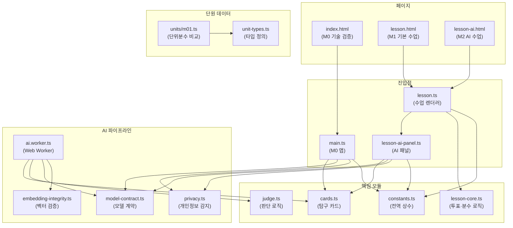
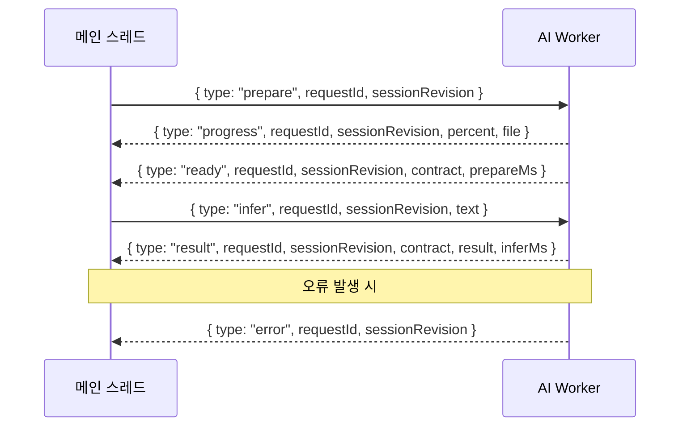
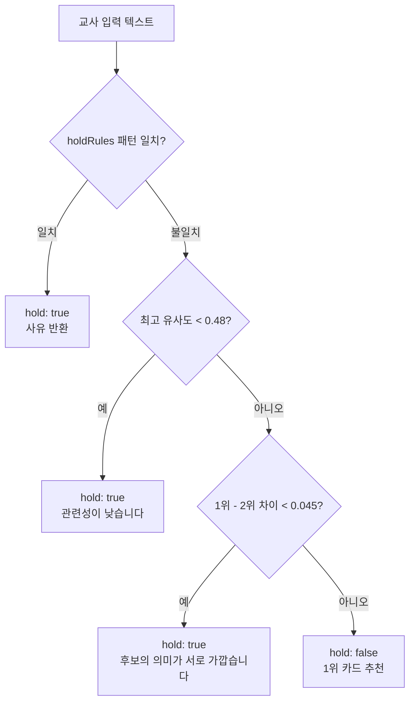

# 아키텍처

이 문서는 **생각의 갈림길 AI** 프로젝트의 기술 아키텍처를 설명합니다.

---

## 모듈 의존성 다이어그램

---

## 페이지 구성

### M0 — 기술 검증 (`index.html` → `main.ts`)

AI 파이프라인의 독립 검증 페이지입니다. 모델 로드, 임베딩 생성, 유사도 비교, 판단 보류 로직을 단독으로 테스트할 수 있습니다.

- 교사가 자유 텍스트를 입력하면 탐구 카드별 유사도 점수를 시각화
- 개발용 예시 질의(E1~E6)를 클릭하여 빠르게 테스트 가능
- 모델 준비 상태·추론 시간·다운로드 진행률 표시

### M1 — 기본 수업 (`lesson.html` → `lesson.ts`)

AI 없이 10단계 수업 흐름만 사용하는 교사용 수업 도구입니다.

- 투표 데이터 입력·검증·차트 시각화
- 분수 막대 시각화
- 이유 카드 선택
- 타이머 기능
- JSON 내보내기

### M2 — AI 수업 (`lesson-ai.html` → `lesson.ts` + `lesson-ai-panel.ts`)

M1의 수업 흐름에 AI 후보 추천 패널을 추가한 페이지입니다.

- M1의 모든 기능 포함
- AI 후보 패널: 교사가 일반적인 개념 설명을 입력하면 가장 관련도 높은 탐구 카드를 AI가 추천
- 교사 확인 버튼: AI 추천을 교사가 수동으로 승인해야 수업에 반영
- 판단 보류 시 사유 표시

---

## Worker 통신 프로토콜

메인 스레드와 `ai.worker.ts` 간의 통신은 `postMessage`를 사용합니다.

### 메시지 종류

| 방향 | 타입 | 설명 |
|------|------|------|
| Main → Worker | `prepare` | 모델 로드 및 카드 벡터 색인 요청 |
| Main → Worker | `infer` | 텍스트 임베딩 및 판단 요청 |
| Worker → Main | `progress` | 모델 다운로드 진행률 |
| Worker → Main | `ready` | 모델 준비 완료 + 모델 계약 |
| Worker → Main | `result` | 추론 결과 + 판단 (hold/추천) |
| Worker → Main | `error` | 오류 발생 |

### 안전 장치

- **`requestId`**: 요청별 고유 ID. 오래된 응답 폐기에 사용
- **`sessionRevision`**: 세션 리비전. 세션 초기화 시 이전 응답을 모두 무효화
- **`contract`**: 모델 계약 문자열. 메인 스레드와 Worker의 모델·색인 계약이 일치하지 않으면 결과를 거부
- **`INFERENCE_TIMEOUT_MS`**: 10초 타임아웃. 초과 시 요청 자동 취소

---

## 판단(Judge) 로직 흐름

### 판단 보류 규칙 (`holdRules`)

| 규칙 | 패턴 | 사유 |
|------|------|------|
| 전체 크기 상이 | `전체.{0,8}(서로 다르\|다르)` | 전체의 크기가 다르다는 조건이 있어 별도 확인 필요 |
| 올바른 설명 | `더 많이 나누면.{0,12}작아` | 같은 전체에서 한 조각이 작아진다는 설명. 혼동으로 단정 안 함 |
| 정보 부족 | `모르겠\|정보가 없\|알 수 없` | 설명 정보가 부족 |

### 유사도 임계값

| 파라미터 | 값 | 설명 |
|---------|-----|------|
| `minSimilarity` | 0.48 | 최소 유사도. 미달 시 판단 보류 |
| `minMargin` | 0.045 | 1위와 2위의 최소 차이. 미달 시 판단 보류 |

> [!NOTE]
> 임계값은 교사 검수 자료로 조정되지 않은 잠정값입니다.

---

## 핵심 설계 결정

### 1. 로컬 전용 AI (Local-Only)

- 모든 AI 추론이 사용자의 브라우저 안에서 실행됩니다.
- `env.allowRemoteModels = false` — 외부 모델 서버 접근을 코드 수준에서 차단합니다.
- ONNX 모델을 WASM 백엔드로 실행하여 GPU 없이도 동작합니다.

### 2. 데이터 비저장 (No Storage)

- 학생 데이터·투표 결과·AI 추론 결과를 `localStorage`, `IndexedDB`, 쿠키 등에 저장하지 않습니다.
- 모든 상태는 JavaScript 메모리에만 존재하며 페이지를 닫으면 소멸합니다.

### 3. 개인정보 우선 (Privacy-First)

- 교사 입력에서 전화번호·이메일·주민등록번호 패턴을 감지하여 경고합니다 (`privacy.ts`).
- 학생 이름·번호·발언 원문 대신 일반적인 개념 설명만 입력하도록 안내합니다.
- 네트워크 요청 없이 동작하므로 데이터 유출 경로가 없습니다.

### 4. 교사 주도 판단

- AI는 탐구 카드를 "후보"로만 제시합니다. 최종 수업 결정은 교사가 합니다.
- 판단 보류(hold) 시 사유를 명시하여 교사가 맥락에 맞게 판단할 수 있도록 합니다.
- 교사 확인 버튼을 눌러야 AI 추천이 수업에 반영됩니다.

### 5. 메인↔Worker 계약 검증

- 메인 스레드와 Worker는 별도 JS 번들로 빌드됩니다.
- 두 번들의 모델·색인 계약(`modelContract`)이 일치하지 않으면 추천을 거부하여 버전 불일치를 방지합니다.

---

## 파일별 역할

| 파일 | 역할 |
|------|------|
| `main.ts` | M0 기술 검증 페이지 진입점. Worker 생성·통신·UI 렌더링 |
| `lesson.ts` | M1/M2 수업 렌더러. 10단계 수업 흐름·투표·차트·타이머·내보내기 |
| `lesson-ai-panel.ts` | M2 AI 후보 패널 UI. Worker 통신·상태 관리·교사 확인 |
| `lesson-core.ts` | 수업 핵심 로직. 참여자 파싱·투표 검증·비율 계산·분수 세그먼트 |
| `ai.worker.ts` | Web Worker. 모델 로드·임베딩 생성·유사도 계산·판단 호출 |
| `judge.ts` | AI 판단 로직. 보류 규칙 배열·유사도 임계값·정렬·판정 |
| `cards.ts` | 탐구 카드 정의(A/B/C)·예시 질의(E1~E6)·기본 매칭 함수 |
| `constants.ts` | 전역 상수 중앙 관리 (타임아웃·글자 수·인원·타이머 등) |
| `model-contract.ts` | 메인↔Worker 모델 계약 생성. 모델 출처·리비전·파일·임베딩 설정·카드 색인 |
| `embedding-integrity.ts` | 임베딩 벡터 무결성 검증. 차원·유한값·정규화 검사 |
| `privacy.ts` | 개인정보 감지 필터. 전화번호·이메일·주민번호 패턴 |
| `unit-types.ts` | 다단원 확장 타입 정의 (`UnitConfig`, `Card`, `Example`, `HoldPattern`) |
| `units/m01.ts` | M01 단위분수 비교 단원 설정. 카드·예시·분모 쌍·보류 패턴·임계값 |
| `style.css` | M0 페이지 스타일 |
| `lesson.css` | 수업 페이지 스타일 (반응형·다크 모드) |
